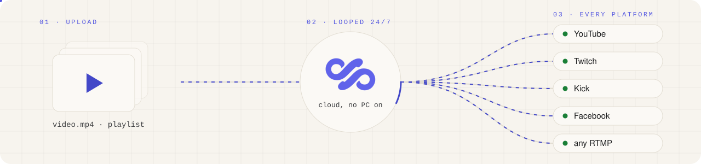
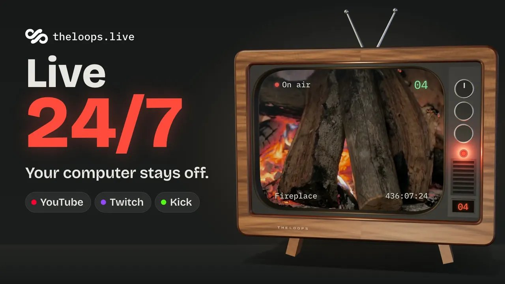
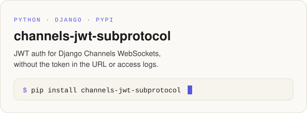
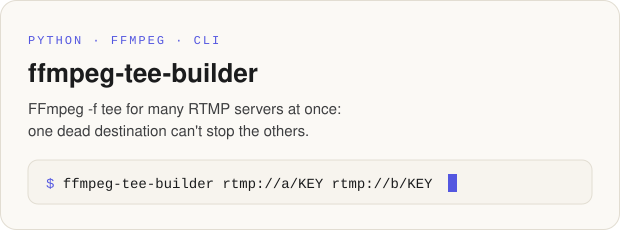
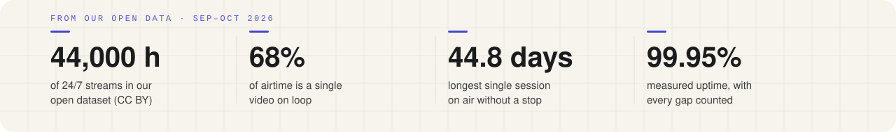

  <a href="https://theloops.live">
    <picture>
      <source media="(prefers-color-scheme: dark)" srcset="assets/banner-dark.svg">
      
    </picture>
  </a>

  
  
  
  

### How it works

<picture>
  <source media="(prefers-color-scheme: dark)" srcset="assets/flow-dark.svg">
  
</picture>

Upload a file or build a playlist, pick the platforms, press start. The stream keeps running on our servers for hours, days or weeks, and restarts itself if a platform drops the connection. Lofi radio, sleep and ambient channels, fireplaces and aquariums, study-with-me, countdowns, gaming highlights.

▶ <a href="https://www.youtube.com/watch?v=MwQ8svenjxs">Watch the 47-second demo</a>

### Open source

Pieces of our own stack, MIT licensed, tested against the real thing.

  <a href="https://github.com/theloops-live/channels-jwt-subprotocol"><picture>
    <source media="(prefers-color-scheme: dark)" srcset="assets/card-jwt-dark.svg">
    
  </picture></a>
  <a href="https://github.com/theloops-live/ffmpeg-tee-builder"><picture>
    <source media="(prefers-color-scheme: dark)" srcset="assets/card-tee-dark.svg">
    
  </picture></a>

### Open data

  <a href="https://theloops.live/research/24-7-streaming-2026"><picture>
    <source media="(prefers-color-scheme: dark)" srcset="assets/stats-dark.svg">
    
  </picture></a>

Aggregate figures from 44,000 hours of 24/7 streams, free under CC BY 4.0: [the report](https://theloops.live/research/24-7-streaming-2026), with a CSV archived on Zenodo as [10.5281/zenodo.24103783](https://doi.org/10.5281/zenodo.24103783). What we learn building it goes into the [engineering notes](https://theloops.live/engineering) ([RSS](https://theloops.live/engineering/feed.xml)).

<a href="https://theloops.live">Website</a> · <a href="https://theloops.live/pricing">Pricing</a> · <a href="https://theloops.live/guides">Guides</a> · <a href="https://theloops.live/tools">Free tools</a> · <a href="https://theloops.live/engineering">Engineering notes</a> · <a href="https://t.me/theloops_support">Support</a>

